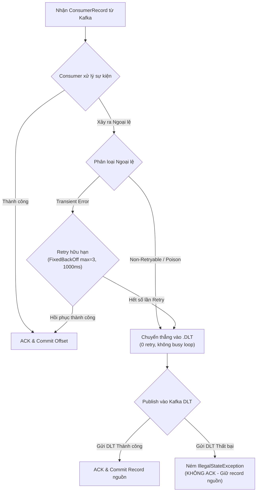

# Kafka Retry, DLQ & Controlled Replay Runbook

> **Tài liệu hướng dẫn vận hành, xử lý Dead-Letter Queue (DLQ) và phát lại sự kiện có kiểm soát cho nền tảng Clucky.**
> Áp dụng cho các domain: `Order` (`cart-order-service`), `Payment` (`payment-service`), `Shipping` (`shipping-service`), `Notification` (`notification-service`), `Promotion & Loyalty` (`promotion-loyalty-service`), `Review & Report` (`review-report-service`).

---

## 1. Mục tiêu & Nguyên tắc cốt lõi

1. **Bảo toàn dữ liệu (Zero Event Loss)**: Không nuốt lỗi (silent swallow). Khi consumer thất bại, chỉ ACK sau khi xử lý thành công hoặc đã đẩy vào topic Dead-Letter (`.DLT`) bền vững. Nếu publish vào DLT thất bại, container ngừng tiến trình offset để giữ nguyên bản ghi nguồn.
2. **Không bận vòng lặp vô ích (No Busy-Loop on Poison Messages)**: Phân loại lỗi rõ ràng. Các lỗi cú pháp, schema không hợp lệ, dữ liệu malformed đi thẳng vào DLT mà không retry. Lỗi tạm thời (transient) được retry có chặn trên (`FixedBackOff`).
3. **Idempotency & Không nhân đôi hiệu ứng (No Duplicate Side-Effects)**: Replay từ DLT giữ nguyên `eventId` và `correlationId` gốc. Từng domain consumer chịu trách nhiệm khử trùng nghiệp vụ (business deduplication).
4. **Bảo mật & Che giấu thông tin nhạy cảm (Sanitization)**: Headers và logs trong DLT tuyệt đối không chứa token, password, apiKey, credit card hoặc PII thô.

---

## 2. Ma trận Cấu hình & Deduplication theo Domain Consumer

| Domain / Service | Consumer Group | Topic Lắng nghe | Topic DLT | Business Dedup Key | Cơ chế bảo vệ Idempotent |
|---|---|---|---|---|---|
| **Notification** (`notification-service`) | `notification-group` | `order.*`, `payment.*`, `promotion.approved` | `<topic>.DLT` | `operationKey = UUID(channel:eventType:eventId:recipient)` | Kiểm tra `notificationRepository.findByOperationKey`. Nếu tồn tại -> skip ghi DB và skip gửi email. |
| **Order** (`cart-order-service`) | `cart-order-service-group` | `payment.failed` | `payment.failed.DLT` | `orderId` / `orderCode` | Kiểm tra `OrderStatus`. Nếu đơn hàng đã `CANCELLED` hoặc trạng thái không hợp lệ -> skip bù trừ. |
| **Report** (`review-report-service`) | `review-report-service` | `order.completed`, `payment.confirmed`, `order.cancelled` | `<topic>.DLT` | `eventId` + `eventType` + `orderId` | Kiểm tra bảng `processed_events.claim(...)`. Nếu eventId đã claim -> return `false`, không cộng doanh thu lần 2. |
| **Loyalty** (`promotion-loyalty-service`) | `promotion-loyalty-service` | `order.completed`, `order.cancelled` | `<topic>.DLT` | `eventId` + `orderId` | Kiểm tra giao dịch tích/trừ điểm trong `loyalty_transactions`. Tránh nhân đôi điểm thưởng. |
| **Payment** (`payment-service`) | `payment-service` | `order.cancelled` | `order.cancelled.DLT` | `paymentId` / `transactionCode` | Kiểm tra trạng thái giao dịch (`REFUNDED` / `FAILED`). |
| **Shipping** (`shipping-service`) | `shipping-service` | `order.created`, `order.cancelled` | `<topic>.DLT` | `orderId` | Kiểm tra bản ghi shipment. Đơn vị chuyển phát chỉ tạo 1 shipment duy nhất. |

---

## 3. Phân loại Ngoại lệ (Exception Classification)



### A. Non-Retryable / Permanent / Poison (Không retry, đi thẳng DLT)
- `java.lang.IllegalArgumentException`: Thiếu trường bắt buộc, payload không đúng business contract.
- `java.lang.IllegalStateException`: Trạng thái hệ thống vi phạm invariant.
- `com.fasterxml.jackson.core.JsonProcessingException`: JSON malformed, hỏng cú pháp.
- `org.springframework.messaging.converter.MessageConversionException`: Sai kiểu dữ liệu envelope.
- `org.springframework.kafka.support.serializer.DeserializationException`: Lỗi giải mã message.
- `java.lang.ClassCastException`: Lỗi ép kiểu payload.

### B. Transient / Retryable (Retry hữu hạn có backoff)
- `org.springframework.web.client.RestClientException` / `ResourceAccessException`: Lỗi mạng, timeout khi gọi downstream REST.
- `java.net.ConnectException`, `java.util.concurrent.TimeoutException`: Kết nối tạm thời gián đoạn.
- `org.springframework.dao.TransientDataAccessException`: Deadlock cơ sở dữ liệu, connection pool cạn tạm thời.

---

## 4. Đặc tả Headers trong Topic Dead-Letter (.DLT)

Mỗi record khi chuyển vào topic `<topic>.DLT` sẽ được giữ nguyên toàn bộ headers gốc (như `X-Event-ID`, `X-Correlation-ID`) và bổ sung các header chẩn đoán sau:

| Header Key | Kiểu dữ liệu | Ý nghĩa | Ví dụ |
|---|---|---|---|
| `X-DLT-Original-Topic` | String | Topic ban đầu mà consumer lắng nghe | `order.completed` |
| `X-DLT-Original-Partition` | String | Partition nguồn | `1` |
| `X-DLT-Original-Offset` | String | Offset của bản ghi gặp lỗi | `10542` |
| `X-DLT-Original-Timestamp` | String | Thời điểm message gốc được tạo (epoch ms) | `1731244800000` |
| `X-DLT-Exception-Class` | String | Tên lớp exception gốc gây ra lỗi (sanitized) | `java.lang.IllegalArgumentException` |
| `X-DLT-Exception-Message` | String | Nội dung lỗi đã qua bộ lọc che giấu bí mật | `Invalid amount for order 102 (token=***)` |
| `X-DLT-Failed-At` | String | Thời điểm đưa vào DLT (ISO-8601 Instant) | `2026-11-10T13:45:00.123Z` |

---

## 5. Quy trình 5 bước Phát lại có kiểm soát (Controlled Replay Procedure)

### Bước 1: Giám sát và Trích xuất sự kiện lỗi từ DLT
Sử dụng Kafka Console Consumer hoặc công cụ quản trị Kafka để đọc các bản ghi trong topic `<topic>.DLT`:
```bash
# Đọc 10 bản ghi gần nhất từ topic DLT kèm headers
kafka-console-consumer \
  --bootstrap-server localhost:9092 \
  --topic order.completed.DLT \
  --from-beginning \
  --property print.key=true \
  --property print.headers=true \
  --property print.timestamp=true \
  --max-messages 10
```
- Đọc giá trị `X-DLT-Exception-Class` và `X-DLT-Exception-Message` để chẩn đoán nguyên nhân (lỗi code, lỗi schema, hoặc downstream sập).

### Bước 2: Dry-run & Xác định Phạm vi Replay
- **Không bao giờ replay hàng loạt toàn bộ topic DLT khi chưa rõ nguyên nhân.**
- Lọc các record cần replay theo:
  - Danh sách `X-Event-ID` cụ thể.
  - Hoặc khoảng thời gian phát sinh sự cố (`X-DLT-Failed-At`).
- Đối chiếu trạng thái hiện tại của cơ sở dữ liệu đích (DB Readback) để xác định xem sự kiện đã từng được xử lý một phần hay chưa.

### Bước 3: Phê duyệt & Ghi nhận Thao tác (Audit Trail)
- Replay phải được thực hiện bởi người có thẩm quyền (System Admin / Technical Lead).
- Ghi nhận thông tin vào log bảo trì:
  - **Operator**: Tên người thực hiện.
  - **Reason**: Lý do replay (ví dụ: đã sửa bug BE-xx, downstream payment đã hồi phục).
  - **Target Event IDs**: Danh sách `eventId` được duyệt replay.
  - **Timestamp**: Thời điểm tiến hành.

### Bước 4: Thực thi Replay (Đẩy lại Topic gốc)
Gửi lại message vào **topic gốc** (giữ nguyên key, value và header `X-Event-ID`, `X-Correlation-ID`).
> **Lưu ý**: Tuyệt đối không xóa header `X-Event-ID` vì đây là chìa khóa để cơ chế idempotent của consumer nhận diện sự kiện lặp.

Ví dụ đẩy lại record qua producer console:
```bash
# Đẩy lại record vào topic gốc
kafka-console-producer \
  --bootstrap-server localhost:9092 \
  --topic order.completed \
  --property parse.key=true \
  --property key.separator=":"
```

### Bước 5: Kiểm tra Hậu Replay & Xác minh Tính Toàn vẹn (Post-Verification)
1. Kiểm tra log consumer đích xem đã log `kafka_listener_returned` thành công hay chưa.
2. Kiểm tra log domain dedup:
   - Nếu là replay lần 2 sau khi đã từng thành công: Quan sát log `*_replay_skipped` (không nhân đôi số tiền, không gửi 2 email, không tích 2 lần điểm).
3. Đọc lại API / DB của service:
   - Khớp trạng thái đơn hàng (`COMPLETED`).
   - Khớp số dư ví điểm.
   - Báo cáo doanh thu chỉ ghi nhận đúng 1 lần cho `orderId`.

---

## 6. Chính sách Bảo mật Dữ liệu (Sanitization & Masking)

1. **Loại bỏ Secret trong DLT Headers**:
   - Tất cả exception message khi ghi vào `X-DLT-Exception-Message` được lọc tự động qua regex `sanitizeErrorMessage`:
     - Che giấu `Bearer <token>` thành `Bearer ***`.
     - Che giấu các trường `password`, `secret`, `apiKey`, `app-password`, `otp` thành `***`.
   - Giới hạn độ dài tối đa 500 ký tự để chống tràn header Kafka.
2. **Không in Raw Payload nhạy cảm vào log lỗi**:
   - Log lỗi trong consumer tuân thủ tiêu chuẩn `SafeLog`, chỉ ghi ID, type và partition/offset, không log toàn bộ body chứa thông tin cá nhân.

