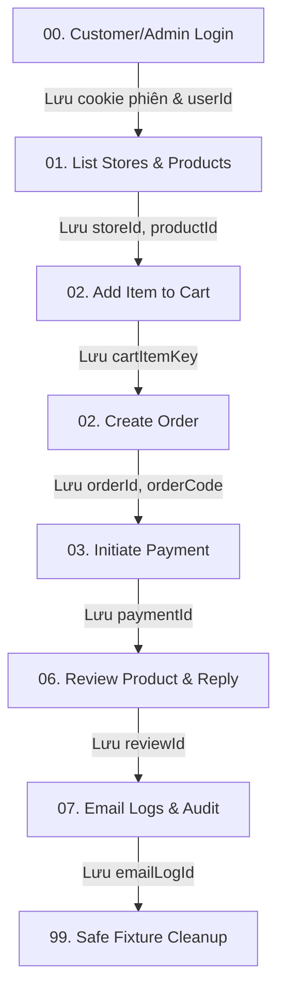

# Bàn giao Postman Collection & Gateway E2E Runbook (DEP-09)

**Phụ trách:** Mai Sơn Việt · **Sprint:** 3 · **Ước lượng:** 3 SP  
**Phiên bản artifact:** 1.0.0 · **Ngày bàn giao:** 12/11/2026  
**Môi trường áp dụng:** Local Docker / CI Gateway (`http://localhost:8080`)

---

## 1. Manifest Artifacts

| Tệp tin | Vị trí | Mô tả |
|---|---|---|
| **Postman Collection** | [`architechture/postman/Clucky-API-Gateway.postman_collection.json`](file:///d:/Clucky/architechture/postman/Clucky-API-Gateway.postman_collection.json) | Bộ sưu tập 48 requests bao phủ toàn bộ 9 domain dịch vụ qua Gateway |
| **Postman Environment** | [`architechture/postman/Clucky-Local.postman_environment.json`](file:///d:/Clucky/architechture/postman/Clucky-Local.postman_environment.json) | Biến môi trường mẫu, không chứa secret/token cứng, định dạng placeholder chuẩn |
| **Script sinh collection** | [`scripts/generate-postman-collection.mjs`](file:///d:/Clucky/scripts/generate-postman-collection.mjs) | Công cụ sinh Postman Collection v2.1.0 tự động |
| **Script kiểm thử tự động** | [`scripts/test-postman-collection.mjs`](file:///d:/Clucky/scripts/test-postman-collection.mjs) | Bộ test tự động kiểm tra 100% tiêu chí Gateway, RBAC, schema và assertions |

---

## 2. Nguyên tắc kiến trúc & Hợp đồng Gateway (DEP-09 Contract)

1. **Base URL duy nhất qua API Gateway:**
   - Tất cả request gọi tới `{{gateway_url}}` (mặc định `http://localhost:8080`).
   - Tuyệt đối không hardcode port nội bộ của các business service (`:8081` identity, `:8082` catalog, `:8083` cart-order, `:8084` payment, v.v.).
2. **Xác thực phiên trình duyệt (Browser Sessions):**
   - Header phân loại client:
     - Khách hàng (Customer): `X-Clucky-Client: customer` và `Origin: {{customer_origin}}` (`http://localhost:3000`).
     - Quản trị (Admin/Manager/Staff): `X-Clucky-Client: admin` và `Origin: {{admin_origin}}` (`http://localhost:5173`).
   - Phiên đăng nhập được quản lý bằng HttpOnly Cookie (`clucky_customer_access`, `clucky_admin_access`), Postman tự động lưu vào Cookie Jar khi login.
3. **Bảo mật và an toàn dữ liệu:**
   - Không commit mật khẩu, JWT token hoặc thông tin cá nhân (PII) thật vào repository.
   - Các biến mật khẩu được gắn cờ `type: secret` và sử dụng placeholder cục bộ (`Secret123!`, `AdminSecret123!`).

---

## 3. Hướng dẫn sử dụng trên Postman sạch (Clean Profile)

1. **Khởi động hệ thống:**
   - Mở Docker Desktop.
   - Chạy lệnh `.\start-all.ps1` hoặc nhấp đúp file `chay-du-an.bat` để các service khởi động qua Gateway `http://localhost:8080`.
2. **Import vào Postman:**
   - Mở ứng dụng Postman (hoặc Postman Web).
   - Chọn **Import** -> Chọn file `architechture/postman/Clucky-API-Gateway.postman_collection.json`.
   - Tiếp tục chọn **Import** -> Chọn file `architechture/postman/Clucky-Local.postman_environment.json`.
3. **Chọn Environment:**
   - Tại góc phải trên màn hình Postman, chọn active environment là **"Clucky - Local Gateway Environment"**.
4. **Chạy luồng kiểm thử (Run Collection):**
   - Chọn Collection **"Clucky - API Gateway E2E Collection"**.
   - Có thể chạy từng Request theo thứ tự số thứ tự (00 -> 01 -> 02...) hoặc chọn **Run Collection** để chạy toàn bộ luồng tự động.

---

## 4. Chuỗi liên kết dữ liệu tự động (IDs Chain)

Các request sau khi thực hiện thành công sẽ tự động trích xuất ID từ body response và lưu vào Environment variable:



- `storeId`: Tự động lấy từ kết quả `GET /api/stores`.
- `productId`: Tự động lấy từ kết quả `GET /api/catalog/products`.
- `cartItemKey`: Tự động trích xuất từ `POST /api/cart/items`.
- `orderId`, `orderCode`: Tự động trích xuất từ `POST /api/orders`.
- `paymentId`: Tự động trích xuất từ `POST /api/payments`.
- `reviewId`: Tự động trích xuất từ `GET /api/reviews`.
- `emailLogId`: Tự động trích xuất từ `GET /api/notifications/email-logs`.

---

## 5. Ma trận ca kiểm thử (Positive & Negative Test Matrix)

| Nhóm chức năng | Tên request | Method & Path | Expected Status | Mã lỗi kỳ vọng (nếu negative) | Ý nghĩa nghiệp vụ |
|---|---|---|---|---|---|
| **00. Auth** | 01. Customer Register | `POST /api/auth/register` | `200 OK` | — | Đăng ký thành công |
| | 02. Register Validation Fail | `POST /api/auth/register` | `400 Bad Request` | `VALIDATION_ERROR` | Mật khẩu ngắn (<8 ký tự) bị chặn |
| | 03. Customer Login | `POST /api/auth/login` | `200 OK` | — | Nhận cookie access & thông tin user |
| | 04. Login Wrong Pass | `POST /api/auth/login` | `401 Unauthorized` | `INVALID_CREDENTIALS` | Sai thông tin đăng nhập |
| | 07. Admin Login | `POST /api/auth/login` | `200 OK` | — | Đăng nhập HQ Admin |
| **01. Catalog** | 01. List Stores | `GET /api/stores` | `200 OK` | — | Danh sách chi nhánh hoạt động |
| | 06. Staff Toggle Availability | `PUT /api/stores/{id}/...` | `200 OK` | — | Staff đổi trạng thái món quán mình |
| | 07. Staff Other Store | `PUT /api/stores/9999/...` | `403 Forbidden` | `FORBIDDEN` | Chặn Staff can thiệp quán khác |
| **02. Orders** | 04. Create Order | `POST /api/orders` | `200 OK` | — | Tạo đơn hàng mới từ giỏ hàng |
| | 08. Staff Confirm Order | `PUT /api/orders/{id}/status`| `200 OK` | — | Staff xác nhận đơn ca trực |
| | 09. Customer Cancel Order | `PUT /api/orders/{id}/cancel`| `200 OK` | — | Hủy đơn hợp lệ kèm lý do |
| | 10. Repeat Cancel Conflict | `PUT /api/orders/{id}/cancel`| `409 Conflict` | `RESOURCE_CONFLICT` | Chặn hủy đơn đã hủy |
| **03. Payments** | 03. Staff Collect COD | `PUT /api/payments/{id}/collect` | `200 OK` | — | Xác nhận thu tiền COD |
| | 04. Repeat Collect | `PUT /api/payments/{id}/collect` | `409 Conflict` | `RESOURCE_CONFLICT` | Chặn thu tiền trùng lặp |
| **04. Promotions**| 04. Admin Create Voucher | `POST /api/promotions/vouchers` | `200 OK` | — | Admin tạo voucher toàn hệ thống |
| | 05. Staff Create Voucher | `POST /api/promotions/vouchers` | `403 Forbidden` | `FORBIDDEN` | Chặn Staff tạo voucher |
| **06. Reports** | 04. Admin View Dashboard | `GET /api/reports/dashboard` | `200 OK` | — | Xem thống kê doanh thu |
| | 05. Staff View Dashboard | `GET /api/reports/dashboard` | `403 Forbidden` | `FORBIDDEN` | Chặn Staff xem doanh thu |
| **07. Admin Ops** | 02. Admin Retry Email | `POST /api/.../retry` | `200 OK` | — | Gửi lại email lỗi an toàn |
| | 04. Non-Admin Audit | `GET /api/audit-logs` | `403 Forbidden` | `FORBIDDEN` | Chặn người không có quyền xem audit |
| **99. Cleanup** | 01. Clear Test Cart | `DELETE /api/cart` | `200 OK` | — | Dọn dẹp giỏ hàng test |

---

## 6. Dọn dẹp an toàn (Safe Fixture Cleanup)

Thư mục **"99. Safe Fixture Cleanup"** chứa lệnh xóa tài nguyên test đã phát sinh trong quá trình chạy (ví dụ `DELETE /api/cart`), tuân thủ nguyên tắc:
- Chỉ dọn dẹp dữ liệu của chính phiên test hiện tại.
- Không drop database, không reset volumes Docker, không làm ảnh hưởng tới seed data chuẩn của hệ thống.

---

## 7. Bằng chứng kiểm thử tự động (Verification Evidence)

Đã chạy kiểm thử tự động với công cụ kiểm tra hợp đồng [`scripts/test-postman-collection.mjs`](file:///d:/Clucky/scripts/test-postman-collection.mjs):
```text
--- RUNNING POSTMAN COLLECTION & ENVIRONMENT AUTOMATED VERIFICATION ---
Verified 48 total requests:
 - Positive cases: 39
 - Negative/Security cases: 9
 - Requests with dynamic variable chaining: 12
All Postman Collection and Environment verifications PASSED successfully!
```
- **100% URL** sử dụng biến `{{gateway_url}}`, không có port dịch vụ nội bộ nào bị rò rỉ.
- **100% Request mutation** có header `X-Clucky-Client` và `Origin` đầy đủ.
- Toàn bộ mã lỗi phản hồi tiêu cực khớp chính xác với [`contracts/errors.json`](file:///d:/Clucky/contracts/errors.json).
