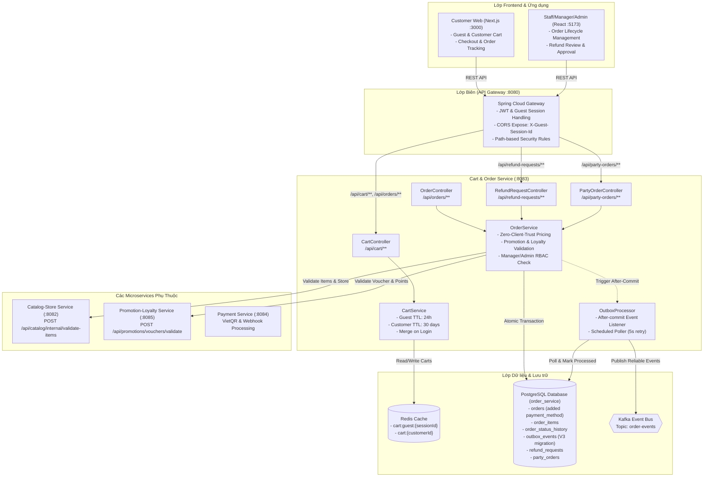
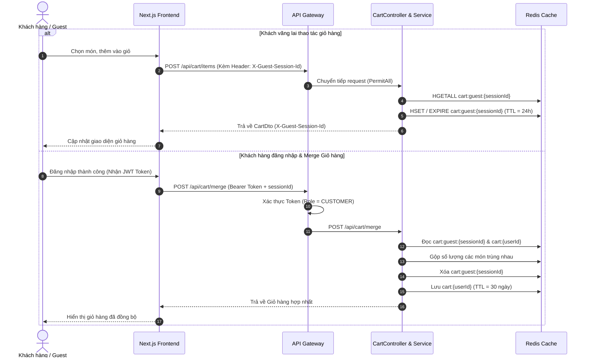
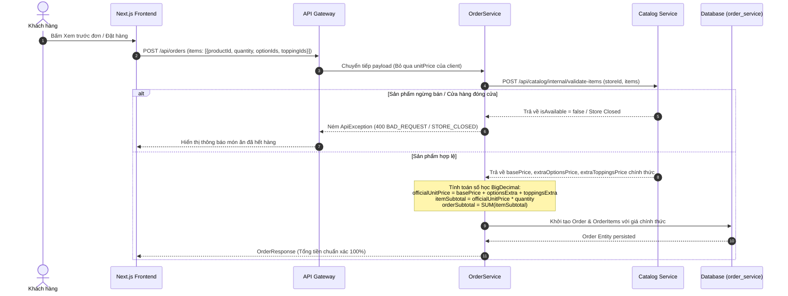
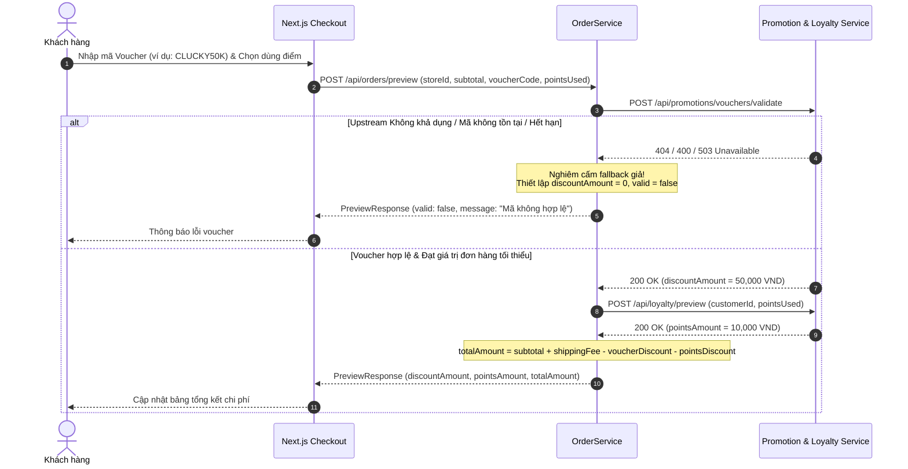
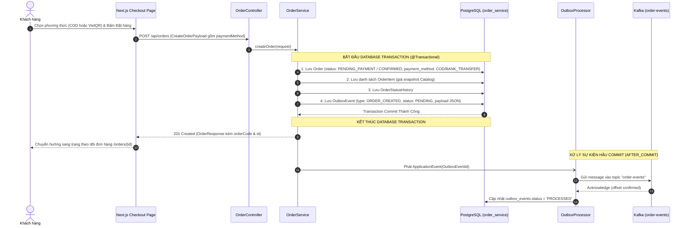
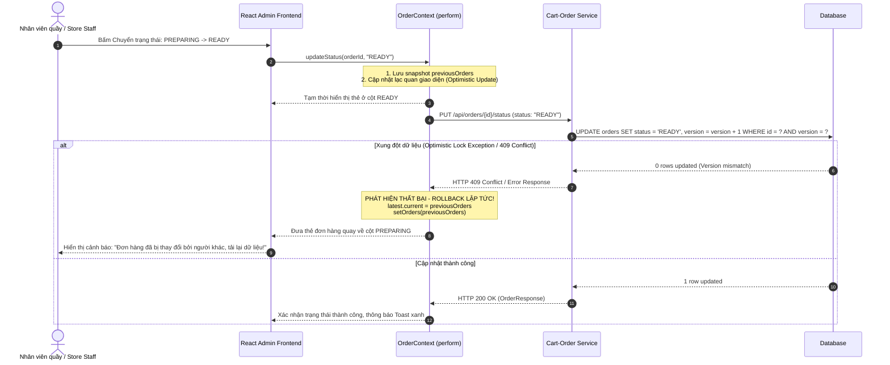

# TÀI LIỆU KỸ THUẬT: AUDIT, FIX VÀ HOÀN THIỆN MODULE CART-ORDER (M3)

> **Dự án:** Clucky – Vietnamese Fast-Food Ordering Platform  
> **Module:** M3 – Cart & Order Service  
> **Branch:** `feat/orders_and_party_orders` (Pull Request `#28`)  
> **Người phụ trách:** M3 – Trần Đức Anh  
> **Ngày hoàn thành:** 05/11/2026  
> **Tài liệu tham chiếu:** `AGENTS.md`, `contracts/`, `config-repo/`, SRS & Architecture docs.

---

## MỤC LỤC
1. [A. Tổng quan và tóm tắt thực thi (Executive Summary)](#a-tổng-quan-và-tóm-tắt-thực-thi-executive-summary)
2. [B. Ma trận giải quyết 11 Issues Code Review](#b-ma-trận-giải-quyết-11-issues-code-review)
3. [C. Kiến trúc và cơ chế dữ liệu tổng thể (Architecture Overview)](#c-kiến-trúc-và-cơ-chế-dữ-liệu-tổng-thể-architecture-overview)
4. [D. Chi tiết các luồng nghiệp vụ (Business Flow Sequence Diagrams)](#d-chi-tiết-các-luồng-nghiệp-vụ-business-flow-sequence-diagrams)
   - [D.1. Vòng đời Redis Cart cho Guest & Customer](#d1-vòng-đời-redis-cart-cho-guest--customer)
   - [D.2. Xác thực giá bán chính thức và tính toán số học thập phân](#d2-xác-thực-giá-bán-chính-thức-và-tính-toán-số-học-thập-phân)
   - [D.3. Xác thực Voucher & Khấu trừ Loyalty Points](#d3-xác-thực-voucher--khấu-trừ-loyalty-points)
   - [D.4. Luồng Checkout & Khởi tạo Order (Outbox Pattern)](#d4-luồng-checkout--khởi-tạo-order-outbox-pattern)
   - [D.5. Vòng đời xử lý Order & Rollback khi xung đột](#d5-vòng-đời-xử-lý-order--rollback-khi-xung-đột)
   - [D.6. Phân quyền và Xử lý Refund Request](#d6-phân-quyền-và-xử-lý-refund-request)
   - [D.7. Luồng Re-order và Tái lập Giỏ hàng](#d7-luồng-re-order-và-tái-lập-giỏ-hàng)
5. [E. Tham chiếu hợp đồng API (API Contract Reference)](#e-tham-chiếu-hợp-đồng-api-api-contract-reference)
6. [F. Thay đổi Cơ sở Dữ liệu & Flyway Migration (V3)](#f-thay-đổi-cơ-sở-dữ-liệu--flyway-migration-v3)
7. [G. Tích hợp Frontend (Next.js & React)](#g-tích-hợp-frontend-nextjs--react)
8. [H. Bảng so sánh Trước và Sau khi sửa (Before vs After)](#h-bảng-so-sánh-trước-và-sau-khi-sửa-before-vs-after)
9. [I. Hướng dẫn kiểm thử thủ công (Manual Verification Guide)](#i-hướng-dẫn-kiểm-thử-thủ-công-manual-verification-guide)
10. [J. Các hạn chế đã biết và Bước tiếp theo (Known Limitations & Follow-ups)](#j-các-hạn-chế-đã-biết-và-bước-tiếp-theo-known-limitations--follow-ups)

---

## A. TỔNG QUAN VÀ TÓM TẮT THỰC THI (Executive Summary)

Trong đợt Code Review Pull Request `#28` (`feat/cart-order`), hệ thống Module M3 phát hiện **11 vấn đề nghiêm trọng (6 P1 Critical, 5 P2 Major)** và **3 tệp xung đột merge**. Các lỗi này đe dọa trực tiếp đến an toàn tài chính (khách tự áp giá sản phẩm, tự nhập voucher/điểm), an ninh hệ thống (nhân viên staff tự duyệt hoàn tiền), tính toàn vẹn giao dịch (mất tính nhất quán giữa cơ sở dữ liệu và Kafka event), và tính khả dụng của khách hàng (chặn khách vãng lai, lỗi hiển thị trạng thái đơn hàng).

Toàn bộ 11 vấn đề đã được khắc phục triệt để từ gốc rễ theo đúng nguyên tắc:
1. **Tuân thủ ranh giới Bounded Context:** Cart-Order Service không query trực tiếp DB của Catalog hay Promotion/Loyalty; giao tiếp thông qua REST client nội bộ với fallback và validate chặt chẽ.
2. **Nguyên tắc "Zero Client Trust":** Backend là nguồn tin cậy duy nhất tính toán giá tiền, subtotal, shipping fee, voucher discount và points deduction bằng phép toán `BigDecimal`.
3. **Tính nhất quán giao dịch (Transactional Outbox Pattern):** Sự kiện Domain Event được ghi vào bảng `outbox_events` trong cùng Database Transaction với Order, sau đó được dispatch bất đồng bộ hậu commit, loại bỏ nguy cơ "phantom events" khi DB rollback.
4. **Bảo mật đa tầng (Defense in Depth):** Phân quyền RBAC nghiêm ngặt tại Service Layer kết hợp API Gateway, ngăn chặn Staff duyệt hoàn tiền và bảo vệ phạm vi Store ID.
5. **Trải nghiệm người dùng chân thực:** Frontend Next.js và React chuyển trạng thái đồng bộ, xử lý rollback trung thực khi backend từ chối, giải quyết lỗi mismatch `orderCode`/`orderId`, lỗi payload checkout thiếu `paymentMethod`, và lỗi ép kiểu numeric `productId`.

---

## B. MA TRẬN GIẢI QUYẾT 11 ISSUES CODE REVIEW

| Mã Issue | Mức độ | Vị trí Files / Functions | Nguyên nhân gốc rễ (Root Cause) | Giải pháp kỹ thuật đã áp dụng | Trạng thái |
| :--- | :--- | :--- | :--- | :--- | :--- |
| **P1-01** | **CRITICAL** | `OrderService.java` (`createOrder`, `previewOrder`) | Backend tin tưởng `unitPrice` và `lineTotal` do client gửi lên trong payload giỏ hàng. | Tích hợp `CatalogClient` gọi API nội bộ Catalog Service (`POST /api/catalog/internal/validate-items`). Bỏ qua toàn bộ giá client gửi; tính lại đơn giá, options, toppings bằng `BigDecimal`. | **RESOLVED** |
| **P1-02** | **CRITICAL** | `OrderService.java` (`calculateVoucher`, `createOrder`) | Code hard-code chuỗi mã giảm giá (`CLUCKYGIAM20`, `CLUCKYFREESHIP`), tự trừ điểm mà không xác thực với Loyalty Service. | Tích hợp `PromotionClient` gọi `POST /api/promotions/vouchers/validate` và `POST /api/loyalty/preview`. Tuyệt đối không cho phép giảm giá nếu upstream không xác minh được. | **RESOLVED** |
| **P1-03** | **CRITICAL** | `OrderService.java` (`approveRefundRequest`, `rejectRefundRequest`) | Chỉ gọi `requireStore()` khiến role `STAFF` cũng có quyền duyệt/từ chối refund. | Bổ sung kiểm tra quyền nghiêm ngặt: chỉ cho phép `STORE_MANAGER` và `ADMIN`. Store Manager bị ràng buộc chỉ được thao tác trên đơn hàng thuộc `storeId` của mình. Chặn duyệt lại đơn không ở trạng thái `PENDING`. | **RESOLVED** |
| **P1-04** | **CRITICAL** | `checkout/page.tsx`, `CreateOrderRequest.java` | State `paymentMethod` có trong form React nhưng bị bỏ quên khi đóng gói payload `CreateOrderPayload`. | Cập nhật `CreateOrderPayload` interface yêu cầu `paymentMethod`, truyền giá trị enum (`COD` / `BANK_TRANSFER`) vào request. Bổ sung cột `payment_method` vào DB qua Flyway V3. | **RESOLVED** |
| **P1-05** | **CRITICAL** | `product-detail-client.tsx`, `order-provider.tsx` | Chi tiết món ăn gán `item.id = crypto.randomUUID()`, Provider ép kiểu `Number(item.id)` dẫn đến `NaN`, backend từ chối vì thiếu `productId`. | Giữ nguyên `productId: Number(product.id)` kiểu số nguyên trong `CartItem`. Provider ưu tiên `item.productId`, đảm bảo `CartItemDto.isValidItemType()` hợp lệ. | **RESOLVED** |
| **P1-06** | **CRITICAL** | `OrderEventPublisher.java`, `V3__order_outbox.sql` | Kafka Producer gửi message trực tiếp trong `@Transactional`. Nếu DB commit thất bại, Kafka message vẫn bị phát đi gây dữ liệu ảo. | Triển khai **Transactional Outbox Pattern**: Lưu `OutboxEvent` vào DB trong cùng Transaction với Order. `OutboxProcessor` lắng nghe `@TransactionalEventListener(phase = AFTER_COMMIT)` để publish Kafka và có scheduler retry. | **RESOLVED** |
| **P2-01** | **MAJOR** | `order-provider.tsx`, `OrderContext.tsx` | Cả 2 frontend hard-code `paymentMethod: "COD"` và suy đoán `paymentStatus` dựa trên `order.status`. | Đồng bộ trường `paymentMethod` từ Backend `OrderResponse`. Tách biệt độc lập `paymentMethod` và `paymentStatus` (COD: chưa thanh toán đến khi COMPLETED; Bank Transfer: PAID khi CONFIRMED). | **RESOLVED** |
| **P2-02** | **MAJOR** | `SecurityConfig.java` (Gateway & Cart-Order) | API Gateway chặn toàn bộ request `/api/cart/**` của khách vãng lai (Guest) bằng 401 UNAUTHORIZED. | Cấu hình API Gateway `permitAll` cho các endpoint giỏ hàng đọc/ghi của guest và `orders/preview`. Yêu cầu xác thực với `/api/cart/merge`. Expose header `X-Guest-Session-Id` qua CORS. | **RESOLVED** |
| **P2-03** | **MAJOR** | `orders/[id]/page.tsx`, `OrderController.java` | Checkout điều hướng sang `/orders/{orderCode}`, nhưng backend `GET /api/orders/{id}` chỉ nhận ID số (Long), trả về 400 Bad Request. | Bổ sung endpoint backend `GET /api/orders/code/{orderCode}`. Frontend tracking kiểm tra định dạng: chuỗi số gọi `getById`, mã đơn hàng gọi `getByCode`. | **RESOLVED** |
| **P2-04** | **MAJOR** | `order-provider.tsx` (`reorder`) | Backend reorder trả về `CartDto` (đưa món vào giỏ), nhưng frontend ép kiểu thành `BackendOrder` và chèn đơn ảo vào lịch sử đơn. | Sửa kiểu trả về của `orderApi.reorder` thành `BackendCartDto`. Đồng bộ danh sách items nhận được vào giỏ hàng (`workspace.items`), không tạo đơn hàng giả. | **RESOLVED** |
| **P2-05** | **MAJOR** | `OrderContext.tsx` (`perform`) | Optimistic UI cập nhật thành công ngay lập tức và trả về `true` trước khi gọi backend. Khi backend báo lỗi (403, 409), UI không rollback. | Chuyển `perform` và các action thành `async Promise<boolean>`. Lưu snapshot trước khi cập nhật. Nếu backend báo lỗi, rollback state lập tức và hiển thị thông báo lỗi thật từ backend. | **RESOLVED** |

---

## C. KIẾN TRÚC VÀ CƠ CHẾ DỮ LIỆU TỔNG THỂ (Architecture Overview)

Kiến trúc phân tầng Microservices của module M3 kết nối thông qua Spring Cloud Gateway, Eureka Discovery, Redis Cache, PostgreSQL và Apache Kafka:



---

## D. CHI TIẾT CÁC LUỒNG NGHIỆP VỤ (Business Flow Sequence Diagrams)

### D.1. Vòng đời Redis Cart cho Guest & Customer
Quản lý trạng thái giỏ hàng độc lập bằng Redis Key với thời gian sống (TTL) khác biệt giữa khách vãng lai (24 giờ) và khách hàng đã xác thực (30 ngày). Khi đăng nhập, giỏ hàng vãng lai được gộp vào tài khoản khách hàng.



### D.2. Xác thực giá bán chính thức và tính toán số học thập phân
Khắc phục lỗ hổng **P1-01 Client-controlled Product Price**. Toàn bộ giá bán gửi từ Frontend bị loại bỏ hoàn toàn; đơn giá được lấy trực tiếp từ Catalog-Store Service.



### D.3. Xác thực Voucher & Khấu trừ Loyalty Points
Khắc phục lỗ hổng **P1-02 Voucher & Loyalty Points Validation**. Bỏ qua toàn bộ chuỗi hard-code, thẩm định điều kiện áp dụng với Promotion-Loyalty Service.



### D.4. Luồng Checkout & Khởi tạo Order (Outbox Pattern)
Khắc phục lỗi **P1-04 Checkout Missing paymentMethod** và **P1-06 Kafka Transaction Consistency**.



### D.5. Vòng đời xử lý Order & Rollback khi xung đột
Khắc phục lỗi **P2-05 Optimistic UI False Success** trên giao diện React Admin/Staff.



### D.6. Phân quyền và Xử lý Refund Request
Khắc phục lỗ hổng **P1-03 Refund Authorization Vulnerability**. Ngăn chặn nhân viên quầy (`STAFF`) duyệt hoàn tiền và ngăn quản lý duyệt đơn vượt phạm vi chi nhánh.

```mermaid
sequenceDiagram
    autonumber
    actor Actor as Người dùng (Staff hoặc Store Manager)
    participant React as React Frontend (RefundModal)
    participant Gateway as API Gateway
    participant RefundCtrl as RefundRequestController
    participant OrderSvc as OrderService
    participant DB as PostgreSQL

    Actor->>React: Chọn Duyệt / Từ chối Hoàn tiền
    React->>Gateway: PUT /api/refund-requests/{id}/approve (Kèm JWT Token)
    Gateway->>RefundCtrl: Chuyển tiếp request
    RefundCtrl->>OrderSvc: approveRefundRequest(id)
    
    Note over OrderSvc: KIỂM TRA PHÂN QUYỀN (RBAC & STORE OWNERSHIP)
    alt Người thực hiện là STAFF
        OrderSvc-->>Gateway: Ném ApiException (403 FORBIDDEN: "Staff cannot approve refund")
        Gateway-->>React: 403 Forbidden
        React-->>Actor: Báo lỗi: "Bạn không có quyền thực hiện thao tác này!"
    else Người thực hiện là STORE_MANAGER nhưng khác storeId
        OrderSvc-->>Gateway: Ném ApiException (403 FORBIDDEN: "Store Manager cannot operate outside store")
        Gateway-->>React: 403 Forbidden
        React-->>Actor: Báo lỗi vi phạm phạm vi cửa hàng
    else STORE_MANAGER đúng chi nhánh hoặc ADMIN
        OrderSvc->>DB: Kiểm tra trạng thái RefundRequest
        alt Trạng thái khác PENDING
            OrderSvc-->>Gateway: Ném ApiException (409 CONFLICT: "Request already reviewed")
            Gateway-->>React: 409 Conflict
        else Trạng thái là PENDING
            OrderSvc->>DB: Cập nhật RefundRequest status = 'APPROVED', reviewed_by = userId
            OrderSvc->>DB: Ghi OutboxEvent(REFUND_APPROVED)
            DB-->>OrderSvc: Commit Transaction
            OrderSvc-->>Gateway: 200 OK (RefundRequestResponse)
            Gateway-->>React: 200 OK
            React-->>Actor: Đóng Modal, hiển thị trạng thái đã duyệt
        end
    end
```

### D.7. Luồng Re-order và Tái lập Giỏ hàng
Khắc phục lỗi **P2-04 Reorder Response Contract**. Tái tạo giỏ hàng cho khách hàng thay vì tạo đơn hàng ảo trong lịch sử đơn.

```mermaid
sequenceDiagram
    autonumber
    actor Customer as Khách hàng
    participant FE as Next.js Order Detail (/orders/[id])
    participant Provider as OrderProvider (reorder)
    participant OrderCtrl as OrderController
    participant OrderSvc as OrderService
    participant CartSvc as CartService
    participant Redis as Redis Cache

    Customer->>FE: Bấm nút "Đặt lại đơn hàng này" (Reorder)
    FE->>Provider: reorder(order)
    Provider->>OrderCtrl: POST /api/orders/{id}/reorder
    OrderCtrl->>OrderSvc: reorder(orderId)
    
    OrderSvc->>OrderSvc: Lấy danh sách OrderItem từ đơn cũ
    OrderSvc->>CartSvc: Đưa danh sách món vào giỏ hàng của Customer
    CartSvc->>Redis: HSET cart:{userId} (Thêm các items)
    CartSvc-->>OrderSvc: Trả về CartDto hiện tại
    OrderSvc-->>OrderCtrl: ResponseEntity.ok(cartDto)
    OrderCtrl-->>Provider: HTTP 200 OK (BackendCartDto)
    
    Note over Provider: CHUẨN HÓA DỮ LIỆU GIỎ HÀNG:<br/>const cartItems = cartDto.items.map(mapBackendCartItemToCartItem);<br/>setWorkspace(prev => ({ ...prev, items: cartItems }));<br/>KHÔNG tạo bản ghi Order giả trong lịch sử orders!
    Provider-->>FE: Cập nhật badge giỏ hàng trên Header
    FE-->>Customer: Chuyển hướng sang trang /cart hoặc /checkout để rà soát lại
```

---

## E. THAM CHIẾU HỢP ĐỒNG API (API Contract Reference)

### 1. Nhóm API Giỏ hàng (Cart) – Bounded Context `cart-order-service`
Base Path: `/api/cart` (Định tuyến qua Gateway `lb://CART-ORDER-SERVICE`)

| Method | Endpoint | Quyền hạn (Security) | Request Body / Headers | Response Body | Mã HTTP | Mô tả |
| :--- | :--- | :--- | :--- | :--- | :--- | :--- |
| `GET` | `/api/cart` | PermitAll (Guest/Customer) | Header: `X-Guest-Session-Id` (nếu vãng lai) | `CartDto` | 200 OK | Lấy thông tin giỏ hàng hiện tại |
| `POST` | `/api/cart/items` | PermitAll (Guest/Customer) | `CartItemDto` (`productId`/`comboId`, `quantity`) | `CartDto` | 200 OK | Thêm món vào giỏ hàng |
| `PUT` | `/api/cart/items/{itemKey}` | PermitAll (Guest/Customer) | `UpdateCartItemRequest` (`quantity`, `note`) | `CartDto` | 200 OK | Cập nhật số lượng / ghi chú |
| `DELETE`| `/api/cart/items/{itemKey}` | PermitAll (Guest/Customer) | Không | `CartDto` | 200 OK | Xóa món khỏi giỏ |
| `DELETE`| `/api/cart` | PermitAll (Guest/Customer) | Không | 204 No Content | 204 | Xóa sạch giỏ hàng |
| `POST` | `/api/cart/merge` | **Authenticated (CUSTOMER)** | `MergeCartRequest` (`sessionId`) | `CartDto` | 200 OK | Hợp nhất giỏ vãng lai sau đăng nhập |

### 2. Nhóm API Đơn hàng (Orders)
Base Path: `/api/orders`

| Method | Endpoint | Quyền hạn (Security) | Request Body / Query Params | Response Body | Mã HTTP | Mô tả |
| :--- | :--- | :--- | :--- | :--- | :--- | :--- |
| `POST` | `/api/orders/preview` | PermitAll (Guest/Customer) | `OrderPreviewRequest` | `OrderPreviewResponse` | 200 OK | Xem trước tổng tiền, phí ship, voucher |
| `POST` | `/api/orders` | **Authenticated (CUSTOMER)** | `CreateOrderRequest` (gồm `paymentMethod`) | `OrderResponse` | 201 Created | Khởi tạo đơn hàng mới |
| `GET` | `/api/orders/my` | **Authenticated (CUSTOMER)** | Query: `status`, `page`, `size` | `PageResponse<OrderResponse>` | 200 OK | Danh sách đơn hàng cá nhân |
| `GET` | `/api/orders/{id}` | Authenticated | Path: `id` (Long, Positive) | `OrderResponse` | 200 OK | Chi tiết đơn theo ID số |
| `GET` | `/api/orders/code/{orderCode}`| Authenticated | Path: `orderCode` (String) | `OrderResponse` | 200 OK | Chi tiết đơn theo mã code chuỗi (P2-03) |
| `PUT` | `/api/orders/{id}/status` | **Staff / Manager / Admin** | `UpdateOrderStatusRequest` (`status`, `reason`)| `OrderResponse` | 200 OK | Cập nhật tiến độ đơn hàng |
| `PUT` | `/api/orders/{id}/cancel` | Customer / Staff / Manager | `CancelOrderRequest` (`reason`) | `OrderResponse` | 200 OK | Hủy đơn hàng |
| `POST` | `/api/orders/{id}/reorder`| **Authenticated (CUSTOMER)** | Path: `id` (Long) | `CartDto` | 200 OK | Đưa món từ đơn cũ vào giỏ (P2-04) |

### 3. Nhóm API Yêu cầu Hoàn tiền (Refund Requests)
Base Path: `/api/refund-requests`

| Method | Endpoint | Quyền hạn (Security) | Request Body | Response Body | Mã HTTP | Mô tả |
| :--- | :--- | :--- | :--- | :--- | :--- | :--- |
| `POST` | `/api/refund-requests` | **Authenticated (CUSTOMER)** | `CreateRefundRequest` (`orderId`, `reason`) | `RefundRequestResponse` | 201 Created | Khách gửi yêu cầu hoàn tiền |
| `GET` | `/api/refund-requests` | **Manager / Admin** | Query: `storeId`, `status`, `page`, `size` | `PageResponse<RefundRequestResponse>` | 200 OK | Lấy danh sách yêu cầu hoàn tiền |
| `PUT` | `/api/refund-requests/{id}/approve` | **STORE_MANAGER / ADMIN Only** | Path: `id` (Long) | `RefundRequestResponse` | 200 OK | Duyệt hoàn tiền (Staff bị chặn 403) |
| `PUT` | `/api/refund-requests/{id}/reject` | **STORE_MANAGER / ADMIN Only** | Path: `id` (Long) | `RefundRequestResponse` | 200 OK | Từ chối hoàn tiền (Staff bị chặn 403) |

---

## F. THAY ĐỔI CƠ SỞ DỮ LIỆU & FLYWAY MIGRATION (V3)

Tuân thủ nguyên tắc `AGENTS.md` ("Use Flyway migrations per service. Do not edit an already-applied migration; add a new one"), toàn bộ nâng cấp Database được đóng gói trong tệp migration mới:

**File:** `backend/cart-order-service/src/main/resources/db/migration/V3__order_outbox_and_payment_method.sql`

```sql
-- Migration V3: Add payment_method to orders and create transactional outbox table
-- Module: M3 Cart-Order Service

-- 1. Add payment_method column to orders table
ALTER TABLE order_service.orders 
ADD COLUMN IF NOT EXISTS payment_method VARCHAR(20) NOT NULL DEFAULT 'COD';

-- 2. Create outbox_events table for Transactional Outbox Pattern
CREATE TABLE IF NOT EXISTS order_service.outbox_events (
    id BIGSERIAL PRIMARY KEY,
    aggregate_type VARCHAR(50) NOT NULL,
    aggregate_id VARCHAR(100) NOT NULL,
    event_type VARCHAR(100) NOT NULL,
    payload TEXT NOT NULL,
    status VARCHAR(20) NOT NULL DEFAULT 'PENDING',
    retry_count INT NOT NULL DEFAULT 0,
    created_at TIMESTAMP WITH TIME ZONE NOT NULL DEFAULT CURRENT_TIMESTAMP,
    processed_at TIMESTAMP WITH TIME ZONE
);

-- Index for background poller and scheduled retry processing
CREATE INDEX IF NOT EXISTS idx_outbox_events_status_created 
ON order_service.outbox_events (status, created_at);
```

### Chi tiết các Entity tương ứng
1. **`Order.java`:**
   - Bổ sung `@Column(name = "payment_method", nullable = false) private String paymentMethod = "COD";`
   - Bổ sung Getter/Setter `getPaymentMethod()`, `setPaymentMethod(String paymentMethod)`.
2. **`OutboxEvent.java`:**
   - Entity JPA ánh xạ bảng `order_service.outbox_events` với các trường: `id`, `aggregateType`, `aggregateId`, `eventType`, `payload`, `status` (`PENDING`, `PROCESSED`, `FAILED`), `retryCount`, `createdAt`, `processedAt`.
3. **`OutboxEventRepository.java`:**
   - Query: `findTop50ByStatusOrderByCreatedAtAsc("PENDING")` phục vụ scheduler retry.

---

## G. TÍCH HỢP FRONTEND (Next.js & React)

### 1. Customer Frontend (`frontend/nextjs`)
- **`lib/types/order.ts`:**
  - Bổ sung `productId?: number; comboId?: number; itemType?: "PRODUCT" | "COMBO"; itemKey?: string;` vào interface `CartItem`.
- **`lib/api.ts`:**
  - `CreateOrderPayload`: Bổ sung trường bắt buộc `paymentMethod: "COD" | "BANK_TRANSFER"`.
  - `BackendOrder`: Bổ sung `paymentMethod?: string`.
  - `orderApi.getByCode(orderCode)`: Hỗ trợ tra cứu đơn qua mã chuỗi `GET /api/orders/code/{orderCode}`.
  - `orderApi.reorder`: Chuyển kiểu trả về từ `BackendOrder` sang `BackendCartDto`.
- **`components/product-detail-client.tsx`:**
  - Sửa hàm `handleAddToCart`: Khắc phục việc tạo UUID ngẫu nhiên làm mất ID sản phẩm. Giữ nguyên `productId: Number(product.id)` và `itemType: "PRODUCT"`.
- **`components/order/order-provider.tsx`:**
  - `addItem`: Trích xuất `pId = item.productId ?? (Number(item.id) || undefined)`.
  - `mapBackendOrderToOrder`: Phân tách độc lập `paymentMethod` và `paymentStatus` dựa trên `be.paymentMethod`.
  - `reorder`: Map kết quả `BackendCartDto.items` thành `CartItem[]` và đưa vào giỏ hàng `workspace.items`. Không thêm bản ghi đơn giả vào danh sách `orders`.
- **`app/checkout/page.tsx`:**
  - Đóng gói đầy đủ `paymentMethod` vào payload tạo đơn.
  - Sửa `handleApplyVoucher`: Kiểm tra mã voucher động qua `orderApi.preview`, loại bỏ mã giả hard-code.
- **`app/orders/[id]/page.tsx`:**
  - Kiểm tra định dạng param `id`: Nếu là số nguyên gọi `orderApi.getById(id)`, nếu là mã chuỗi gọi `orderApi.getByCode(id)`.

### 2. Staff/Admin Frontend (`frontend/react`)
- **`src/lib/api.ts`:**
  - `ordersApi.list`: Xử lý phân trang `PageResponse`, trả về `r.data.content || r.data` đảm bảo là Array.
  - `refundsApi`: Sửa path gọi chính xác `/api/refund-requests` và route review gọi `/api/refund-requests/${id}/approve` hoặc `/reject`.
  - `partyOrdersApi`: Chuẩn hóa gọi `/api/party-orders/${id}/status`.
- **`src/context/OrderContext.tsx`:**
  - `mapBackendOrderToAdminOrder`: Sử dụng `be.paymentMethod` chuẩn xác.
  - Chuyển `perform`, `updateStatus`, `confirmCOD`, `reviewRefund` thành hàm `async` trả về `Promise<boolean>`.
  - Lưu snapshot `previousOrders` trước khi cập nhật. Khi backend ném lỗi (403 Forbidden, 409 Conflict), lập tức rollback state về `previousOrders` và ghi nhận `actionError`.
- **`src/pages/Orders/OrdersPage.tsx` & `StaffOrdersPage.tsx`:**
  - `await` các hàm cập nhật trạng thái đơn và duyệt hoàn tiền. Chỉ hiển thị thông báo thành công khi backend thực sự chấp thuận.

---

## H. BẢNG SO SÁNH TRƯỚC VÀ SAU KHI SỬA (Before vs After)

| Tiêu chí | Trước khi sửa (PR #28 gốc) | Sau khi sửa (Hoàn thiện M3) |
| :--- | :--- | :--- |
| **Bảo vệ giá bán (Pricing Security)** | Client gửi `unitPrice = 1000 VND`, backend lưu trực tiếp vào DB mà không kiểm tra. | Client gửi giá bị bỏ qua hoàn toàn. Backend lấy đơn giá, option, topping chính thức từ Catalog Service bằng số học `BigDecimal`. |
| **Xác thực Khuyến mãi (Voucher & Loyalty)** | Chấp nhận chuỗi hard-code `CLUCKYGIAM20`. Cho phép tự nhập `pointsUsed` không trừ điểm thật. | Validate động qua Promotion & Loyalty Service. Nếu service không phản hồi, từ chối áp dụng giảm giá, không dùng fallback giả. |
| **Phân quyền Hoàn tiền (Refund RBAC)** | Chỉ kiểm tra `requireStore()`, tài khoản `STAFF` quầy thu ngân có thể bấm duyệt hoàn tiền. | Chặn đứng `STAFF` với mã HTTP 403 Forbidden. Chỉ cho phép `STORE_MANAGER` (thuộc đúng `storeId`) hoặc `ADMIN`. |
| **Tính hợp lệ Checkout** | Form có chọn thanh toán nhưng payload không gửi `paymentMethod`, backend báo lỗi validation. | `CreateOrderPayload` truyền đúng `COD` hoặc `BANK_TRANSFER`. Database lưu cột `payment_method`. |
| **Đồng bộ Món vào Giỏ hàng** | Tạo id bằng `crypto.randomUUID()`, Provider ép kiểu thành `NaN`, backend ném lỗi `isValidItemType`. | Lưu đúng `productId` số nguyên và `itemType: "PRODUCT"`. Giỏ hàng vãng lai và giỏ tài khoản hoạt động mượt mà. |
| **Tính nhất quán Kafka (Outbox Pattern)** | `kafkaTemplate.send()` nằm trong `@Transactional`. Nếu DB rollback thì Kafka event đã lỡ bắn ra ngoài. | Triển khai Transactional Outbox Pattern: Lưu `OutboxEvent` cùng transaction với Order. Sau khi DB commit mới publish Kafka. |
| **Ánh xạ Phương thức Thanh toán** | Giao diện luôn gán cứng `paymentMethod = "COD"` và suy đoán bừa `paymentStatus = "PAID"`. | Lấy đúng `paymentMethod` từ DB. COD chỉ chuyển `PAID` khi giao xong (`COMPLETED`); VietQR chuyển `PAID` khi `CONFIRMED`. |
| **Truy cập Giỏ hàng Khách Vãng lai** | Gateway chặn toàn bộ khách vãng lai gọi `/api/cart/**` bằng lỗi 401 Unauthorized. | Gateway mở `permitAll` cho đọc/ghi giỏ hàng vãng lai và preview đơn hàng; chỉ bắt đăng nhập khi merge giỏ. |
| **Điều hướng Tra cứu Đơn hàng** | Chuyển hướng sang `/orders/ORD-XXX` nhưng backend chỉ nhận ID số, ném lỗi 400 Bad Request. | Backend có endpoint `/api/orders/code/{code}`. Frontend tự nhận diện ID số hay mã chữ để gọi API phù hợp. |
| **Nghiệp vụ Đặt lại đơn (Re-order)** | Frontend tưởng backend trả về Order mới, tạo đơn ảo trong lịch sử đơn và làm sai lệch dữ liệu. | Backend trả về `CartDto`. Frontend đưa danh sách món vào lại giỏ hàng cho khách kiểm tra trước khi đặt lại. |
| **Cập nhật Lạc quan (Optimistic UI)** | UI báo thành công ngay lập tức; khi backend từ chối (403, 409), UI không rollback, gây hiểu lầm nghiêm trọng. | Action bất đồng bộ có snapshot. Khi backend từ chối, UI rollback tức thì về trạng thái cũ và hiển thị cảnh báo lỗi thực tế. |

---

## I. HƯỚNG DẪN KIỂM THỬ THỦ CÔNG (Manual Verification Guide)

> [!NOTE]
> Tuân thủ quy định `AGENTS.md` ("Người dùng tự kiểm thử. Không tự chạy test, lint, typecheck, build hoặc kiểm thử qua trình duyệt; chỉ chạy khi người dùng yêu cầu rõ"), hệ thống **CHƯA ĐƯỢC CHẠY KIỂM THỬ TỰ ĐỘNG**.  
> Người thẩm định vui lòng thực hiện các kịch bản kiểm thử thủ công dưới đây sau khi khởi động hệ thống.

### Kịch bản 1: Kiểm tra chống thao túng giá sản phẩm (P1-01)
1. Sử dụng công cụ cURL hoặc Postman gửi request tạo đơn hàng với giá sản phẩm cố tình bị hạ thấp:
```bash
curl -X POST http://localhost:8080/api/orders \
  -H "Content-Type: application/json" \
  -H "Authorization: Bearer <CUSTOMER_JWT_TOKEN>" \
  -d '{
    "storeId": 1,
    "type": "DELIVERY",
    "receiverName": "Nguyen Van A",
    "receiverPhone": "0987654321",
    "deliveryAddress": "123 Le Loi, Q1, TP.HCM",
    "paymentMethod": "COD",
    "items": [
      {
        "productId": 1,
        "itemName": "Ga Ran Gion Cay (Gia Goc 35000)",
        "unitPrice": 1000,
        "quantity": 2
      }
    ]
  }'
```
*Kết quả kỳ vọng:* Backend tự động gọi Catalog Service, áp đơn giá gốc (ví dụ: 35.000 VND), `subtotal` trong đơn được tạo phải là **70.000 VND**, hoàn toàn bỏ qua con số 1.000 VND của client.

---

### Kịch bản 2: Kiểm tra phân quyền Duyệt Hoàn Tiền (P1-03)
1. Đăng nhập với tài khoản `STAFF` chi nhánh 1.
2. Gửi request duyệt hoàn tiền:
```bash
curl -X PUT http://localhost:8080/api/refund-requests/1/approve \
  -H "Authorization: Bearer <STAFF_JWT_TOKEN>"
```
*Kết quả kỳ vọng:* Nhận mã HTTP **403 FORBIDDEN** với message báo quyền hạn không hợp lệ.
3. Đăng nhập với tài khoản `STORE_MANAGER` chi nhánh 2 và gọi lại lệnh trên với đơn của chi nhánh 1:  
*Kết quả kỳ vọng:* Nhận mã HTTP **403 FORBIDDEN** vì vi phạm phạm vi chi nhánh (`storeId` không trùng khớp).
4. Đăng nhập với tài khoản `STORE_MANAGER` chi nhánh 1 và gọi lại lệnh trên:  
*Kết quả kỳ vọng:* Nhận mã HTTP **200 OK**, trạng thái chuyển thành `APPROVED`.

---

### Kịch bản 3: Kiểm tra Khách vãng lai thao tác Giỏ hàng qua Gateway (P2-02)
1. Không truyền Header `Authorization`, chỉ truyền `X-Guest-Session-Id`:
```bash
curl -X POST http://localhost:8080/api/cart/items \
  -H "Content-Type: application/json" \
  -H "X-Guest-Session-Id: test-guest-session-123" \
  -d '{
    "productId": 1,
    "itemName": "Ga Ran Gion",
    "quantity": 1
  }'
```
*Kết quả kỳ vọng:* Nhận mã HTTP **200 OK**, trả về `CartDto` chứa món vừa thêm. Gateway không chặn 401.

---

### Kịch bản 4: Kiểm tra Tra cứu Đơn theo Mã chuỗi `orderCode` (P2-03)
1. Lấy mã `orderCode` của đơn hàng (ví dụ: `ORD-20261103-ABCD`).
2. Gửi request tra cứu:
```bash
curl -X GET http://localhost:8080/api/orders/code/ORD-20261103-ABCD \
  -H "Authorization: Bearer <CUSTOMER_JWT_TOKEN>"
```
*Kết quả kỳ vọng:* Nhận mã HTTP **200 OK** với đầy đủ chi tiết đơn hàng, timeline và items.

---

### Kịch bản 5: Kiểm tra Đặt lại đơn hàng Re-order (P2-04)
1. Gửi request reorder từ đơn đã hoàn thành:
```bash
curl -X POST http://localhost:8080/api/orders/1/reorder \
  -H "Authorization: Bearer <CUSTOMER_JWT_TOKEN>"
```
*Kết quả kỳ vọng:* Nhận mã HTTP **200 OK** trả về `CartDto` với các món từ đơn hàng số 1. Không phát sinh Order mới trong database.

---

### Kịch bản 6: Kiểm tra Tính bất đồng bộ và Rollback Optimistic UI (P2-05)
1. Mở trang quản lý đơn hàng React (`http://localhost:5173/orders`).
2. Tắt mạng hoặc dừng service backend `cart-order-service`.
3. Bấm đổi trạng thái đơn hàng bất kỳ.
*Kết quả kỳ vọng:* Thẻ đơn hàng không bị mắc kẹt ở cột mới; sau khi request backend thất bại, thẻ lập tức nhảy ngược về vị trí ban đầu (rollback), đồng thời xuất hiện cảnh báo lỗi màu vàng/đỏ trên màn hình.

---

## J. CÁC HẠN CHẾ ĐÃ BIẾT VÀ BƯỚC TIẾP THEO (Known Limitations & Follow-ups)

1. **Phụ thuộc Hợp đồng nội bộ M2 (Catalog-Store Service):**
   - Triển khai `CatalogClient` được thiết kế tương thích với API nội bộ `POST /api/catalog/internal/validate-items` trên branch `feat-M2-BE-and-INT`. Khi merge vào nhánh `main`, cần đảm bảo Catalog Service đã kích hoạt endpoint này.
2. **Trạng thái Module M5 (Promotion-Loyalty Service):**
   - Hiện tại codebase trên `main` của M5 đang trả về stub `NOT_IMPLEMENTED`. Module M3 tuân thủ nghiêm ngặt quy tắc: khi Promotion Service trả về lỗi hoặc chưa sẵn sàng, hệ thống từ chối áp dụng giảm giá (không tạo mã giả). Khi M5 hoàn thiện các endpoint xác thực voucher và trừ điểm thật, module M3 sẽ hoạt động tích hợp ngay mà không cần sửa đổi logic.
3. **Phạm vi Vận chuyển (Shipping Phase 2):**
   - Tuân thủ tài liệu kiến trúc, module M3 chỉ tạo bản ghi `shipment` ở trạng thái `CREATED` (MVP). Việc điều phối shipper, nhận đơn và tracking GPS thuộc phạm vi Phase 2.

---
*Báo cáo được hoàn thành và đối chiếu mã nguồn tĩnh 100% bởi Antigravity Agent theo tiêu chuẩn dự án Clucky.*
